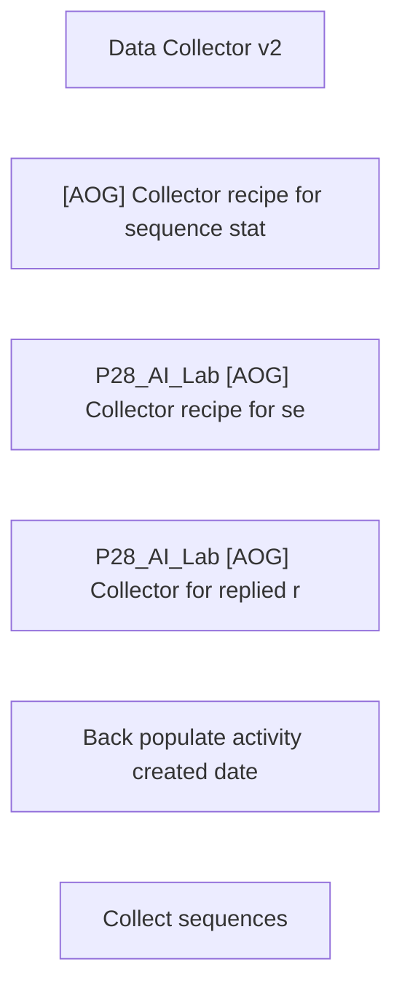

# Lineage — [AOG] Job Collectors (DEV)

_Generated by estate-architect 2026-10-12 from the corpus index (heuristic edges from recipe descriptions; verify before acting)._
6 recipes in folder, 19,868,799 lifetime tasks total. Top recipes by task load:

- [Data Collector v2](https://app.workato.com/recipes/66886428) — 13,880,718 tasks, ok=17,231/fail=68, last_run=2025-10-16 (index last_run UNVERIFIED for running recipes)
- [[AOG] Collector recipe for sequence states](https://app.workato.com/recipes/63733129) — 5,372,449 tasks, ok=4,991,487/fail=118, last_run=2025-06-30
- [P28_AI_Lab [AOG] Collector recipe for sequence states](https://app.workato.com/recipes/66267377) — 547,953 tasks, ok=515,533/fail=4,080, last_run=2025-10-01
- [P28_AI_Lab [AOG] Collector for replied records](https://app.workato.com/recipes/66913496) — 55,371 tasks, ok=713,500/fail=12,980, last_run=2025-11-06
- [Back populate activity created date](https://app.workato.com/recipes/63738532) — 12,250 tasks, ok=36/fail=3, last_run=2025-06-30 (index last_run UNVERIFIED for running recipes)
- [Collect sequences](https://app.workato.com/recipes/63765288) — 58 tasks, ok=43/fail=0, last_run=2025-06-30 (index last_run UNVERIFIED for running recipes)

