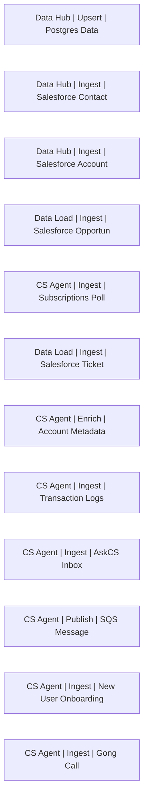

# Lineage — Ingest (PROD)

_Generated by estate-architect 2026-10-12 from the corpus index (heuristic edges from recipe descriptions; verify before acting)._
22 recipes in folder, 17,065,744 lifetime tasks total. Top recipes by task load:

- [Data Hub | Upsert | Postgres Data](https://app.workato.com/recipes/73203547) — 9,001,704 tasks, ok=2,250,458/fail=4, last_run=2026-09-01 (index last_run UNVERIFIED for running recipes)
- [Data Hub | Ingest | Salesforce Contact](https://app.workato.com/recipes/73203545) — 4,193,844 tasks, ok=1,228,875/fail=1,309, last_run=2026-08-27 (index last_run UNVERIFIED for running recipes)
- [Data Hub | Ingest | Salesforce Account](https://app.workato.com/recipes/73203544) — 2,296,366 tasks, ok=645,977/fail=1,897, last_run=2026-09-01 (index last_run UNVERIFIED for running recipes)
- [Data Load | Ingest | Salesforce Opportunity](https://app.workato.com/recipes/73203548) — 1,202,047 tasks, ok=360,710/fail=233, last_run=2026-10-07 (index last_run UNVERIFIED for running recipes)
- [CS Agent | Ingest | Subscriptions Poll](https://app.workato.com/recipes/73196985) — 80,504 tasks, ok=31,724/fail=2, last_run=2026-07-28 (index last_run UNVERIFIED for running recipes)
- [Data Load | Ingest | Salesforce Ticket](https://app.workato.com/recipes/73203549) — 73,819 tasks, ok=20,617/fail=4, last_run=2026-08-27 (index last_run UNVERIFIED for running recipes)
- [CS Agent | Enrich | Account Metadata](https://app.workato.com/recipes/70971329) — 61,149 tasks, ok=12,147/fail=0, last_run=2026-09-10 (index last_run UNVERIFIED for running recipes)
- [CS Agent | Ingest | Transaction Logs](https://app.workato.com/recipes/71939282) — 53,866 tasks, ok=26,946/fail=1, last_run=2026-05-19 (index last_run UNVERIFIED for running recipes)
- [CS Agent | Ingest | AskCS Inbox](https://app.workato.com/recipes/71939281) — 34,755 tasks, ok=6,054/fail=5, last_run=2026-07-28 (index last_run UNVERIFIED for running recipes)
- [CS Agent | Publish | SQS Message](https://app.workato.com/recipes/72213769) — 22,304 tasks, ok=11,152/fail=50, last_run=2026-06-08 (index last_run UNVERIFIED for running recipes)
- [CS Agent | Ingest | New User Onboarding](https://app.workato.com/recipes/73577383) — 11,790 tasks, ok=1,965/fail=0, last_run=2026-07-28 (index last_run UNVERIFIED for running recipes)
- [CS Agent | Ingest | Gong Call](https://app.workato.com/recipes/73577382) — 10,675 tasks, ok=1,787/fail=0, last_run=2026-07-29 (index last_run UNVERIFIED for running recipes)

