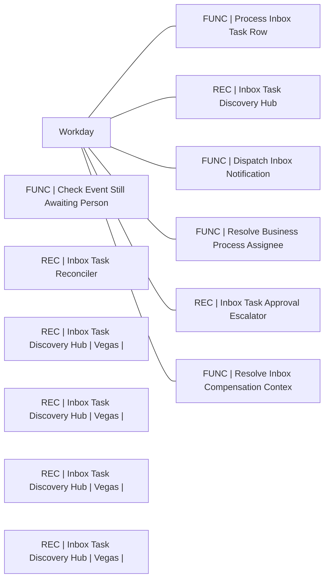

# Lineage — Inbox Tasks (DEV)

_Generated by estate-architect 2026-10-12 from the corpus index (heuristic edges from recipe descriptions; verify before acting)._
16 recipes in folder, 57,167,919 lifetime tasks total. Top recipes by task load:

- [FUNC | Process Inbox Task Row](https://app.workato.com/recipes/74482074) — 46,930,169 tasks, ok=6,480,471/fail=31, last_run=2026-10-10 (index last_run UNVERIFIED for running recipes)
- [REC | Inbox Task Discovery Hub](https://app.workato.com/recipes/74482795) — 2,863,415 tasks, ok=14,100/fail=1,048, last_run=2026-10-10 (index last_run UNVERIFIED for running recipes)
- [FUNC | Check Event Still Awaiting Person](https://app.workato.com/recipes/74506696) — 1,613,824 tasks, ok=508,882/fail=25,236, last_run=2026-09-03 (index last_run UNVERIFIED for running recipes)
- [REC | Inbox Task Reconciler](https://app.workato.com/recipes/74506733) — 1,074,336 tasks, ok=6,324/fail=0, last_run=2026-10-08
- [REC | Inbox Task Discovery Hub | Vegas | Offset 1m](https://app.workato.com/recipes/82531467) — 919,360 tasks, ok=4,262/fail=170, last_run=2026-10-05
- [REC | Inbox Task Discovery Hub | Vegas | Offset 4m](https://app.workato.com/recipes/82531480) — 919,149 tasks, ok=4,261/fail=170, last_run=2026-10-05
- [REC | Inbox Task Discovery Hub | Vegas | Offset 3m](https://app.workato.com/recipes/82531470) — 919,147 tasks, ok=4,261/fail=172, last_run=2026-10-05
- [REC | Inbox Task Discovery Hub | Vegas | Offset 2m](https://app.workato.com/recipes/82531469) — 918,928 tasks, ok=4,260/fail=172, last_run=2026-10-05
- [FUNC | Dispatch Inbox Notification](https://app.workato.com/recipes/82059061) — 510,184 tasks, ok=128,296/fail=28, last_run=2026-10-08 (index last_run UNVERIFIED for running recipes)
- [FUNC | Resolve Business Process Assignee](https://app.workato.com/recipes/74437245) — 474,878 tasks, ok=102,641/fail=91, last_run=2026-09-03 (index last_run UNVERIFIED for running recipes)
- [REC | Inbox Task Approval Escalator](https://app.workato.com/recipes/74505400) — 19,991 tasks, ok=6,668/fail=0, last_run=2026-10-05 (index last_run UNVERIFIED for running recipes)
- [FUNC | Resolve Inbox Compensation Context](https://app.workato.com/recipes/79410133) — 4,366 tasks, ok=750/fail=276, last_run=2026-09-09 (index last_run UNVERIFIED for running recipes)

