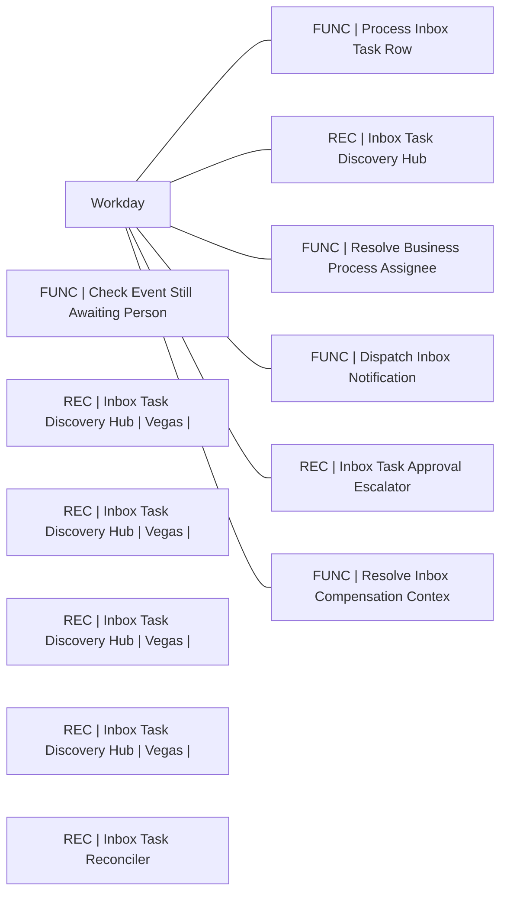

# Lineage — Inbox Tasks (PROD)

_Generated by estate-architect 2026-10-12 from the corpus index (heuristic edges from recipe descriptions; verify before acting)._
13 recipes in folder, 46,760,128 lifetime tasks total. Top recipes by task load:

- [FUNC | Process Inbox Task Row](https://app.workato.com/recipes/82120559) — 39,258,694 tasks, ok=5,112,138/fail=15, last_run=2026-10-10 (index last_run UNVERIFIED for running recipes)
- [REC | Inbox Task Discovery Hub](https://app.workato.com/recipes/82120563) — 1,808,854 tasks, ok=9,230/fail=7, last_run=2026-10-10 (index last_run UNVERIFIED for running recipes)
- [FUNC | Check Event Still Awaiting Person](https://app.workato.com/recipes/82120556) — 839,904 tasks, ok=279,968/fail=28, last_run=2026-10-10 (index last_run UNVERIFIED for running recipes)
- [REC | Inbox Task Discovery Hub | Vegas | Offset 4m](https://app.workato.com/recipes/82641524) — 830,527 tasks, ok=3,145/fail=6, last_run=2026-10-10 (index last_run UNVERIFIED for running recipes)
- [REC | Inbox Task Discovery Hub | Vegas | Offset 1m](https://app.workato.com/recipes/82641521) — 830,251 tasks, ok=3,146/fail=4, last_run=2026-10-10 (index last_run UNVERIFIED for running recipes)
- [REC | Inbox Task Discovery Hub | Vegas | Offset 2m](https://app.workato.com/recipes/82641522) — 830,063 tasks, ok=3,145/fail=5, last_run=2026-10-10 (index last_run UNVERIFIED for running recipes)
- [REC | Inbox Task Discovery Hub | Vegas | Offset 3m](https://app.workato.com/recipes/82641523) — 829,843 tasks, ok=3,144/fail=5, last_run=2026-10-10 (index last_run UNVERIFIED for running recipes)
- [FUNC | Resolve Business Process Assignee](https://app.workato.com/recipes/82120560) — 648,884 tasks, ok=139,947/fail=113, last_run=2026-10-10 (index last_run UNVERIFIED for running recipes)
- [REC | Inbox Task Reconciler](https://app.workato.com/recipes/82120564) — 635,458 tasks, ok=3,518/fail=1, last_run=2026-10-10 (index last_run UNVERIFIED for running recipes)
- [FUNC | Dispatch Inbox Notification](https://app.workato.com/recipes/82120557) — 119,603 tasks, ok=24,019/fail=0, last_run=2026-09-09 (index last_run UNVERIFIED for running recipes)
- [REC | Inbox Task Approval Escalator](https://app.workato.com/recipes/82120562) — 109,914 tasks, ok=3,567/fail=0, last_run=2026-10-10 (index last_run UNVERIFIED for running recipes)
- [FUNC | Resolve Inbox Compensation Context](https://app.workato.com/recipes/82120561) — 18,090 tasks, ok=2,474/fail=867, last_run=2026-10-10 (index last_run UNVERIFIED for running recipes)

