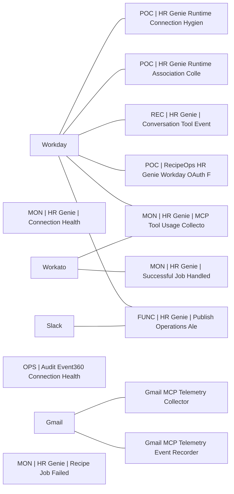

# Lineage — Operational Monitoring (PROD)

_Generated by estate-architect 2026-10-12 from the corpus index (heuristic edges from recipe descriptions; verify before acting)._
49 recipes in folder, 29,145,036 lifetime tasks total. Top recipes by task load:

- [POC | HR Genie Runtime Connection Hygiene Audit](https://app.workato.com/recipes/82242831) — 20,748,278 tasks, ok=8,829/fail=196, last_run=2026-10-05 (index last_run UNVERIFIED for running recipes)
- [MON | HR Genie | Connection Health](https://app.workato.com/recipes/82120581) — 2,126,871 tasks, ok=10,687/fail=3, last_run=2026-09-05 (index last_run UNVERIFIED for running recipes)
- [MON | HR Genie | Successful Job Handled Error Backstop](https://app.workato.com/recipes/82259105) — 1,913,407 tasks, ok=8,877/fail=2, last_run=2026-10-04 (index last_run UNVERIFIED for running recipes)
- [Gmail MCP Telemetry Collector](https://app.workato.com/recipes/79525048) — 1,443,422 tasks, ok=11,651/fail=793, last_run=2026-09-08 (index last_run UNVERIFIED for running recipes)
- [POC | HR Genie Runtime Association Collector](https://app.workato.com/recipes/82242830) — 1,119,013 tasks, ok=7,766/fail=3, last_run=2026-09-10 (index last_run UNVERIFIED for running recipes)
- [OPS | Audit Event360 Connection Health](https://app.workato.com/recipes/82045839) — 444,453 tasks, ok=11,401/fail=0, last_run=2026-09-02 (index last_run UNVERIFIED for running recipes)
- [REC | HR Genie | Conversation Tool Event Collector](https://app.workato.com/recipes/82178945) — 341,963 tasks, ok=3,185/fail=8, last_run=2026-09-08 (index last_run UNVERIFIED for running recipes)
- [MON | HR Genie | MCP Tool Usage Collector](https://app.workato.com/recipes/82120584) — 283,708 tasks, ok=3,564/fail=1, last_run=2026-09-05 (index last_run UNVERIFIED for running recipes)
- [POC | RecipeOps HR Genie Workday OAuth Failure Listener](https://app.workato.com/recipes/82242833) — 161,938 tasks, ok=53,979/fail=2, last_run=2026-09-10 (index last_run UNVERIFIED for running recipes)
- [Gmail MCP Telemetry Event Recorder](https://app.workato.com/recipes/79525049) — 105,358 tasks, ok=52,679/fail=4, last_run=2026-09-02 (index last_run UNVERIFIED for running recipes)
- [FUNC | HR Genie | Publish Operations Alert](https://app.workato.com/recipes/82120576) — 89,817 tasks, ok=29,849/fail=1, last_run=2026-10-05 (index last_run UNVERIFIED for running recipes)
- [MON | HR Genie | Recipe Job Failed](https://app.workato.com/recipes/82120585) — 71,690 tasks, ok=66,511/fail=7, last_run=2026-09-04 (index last_run UNVERIFIED for running recipes)

