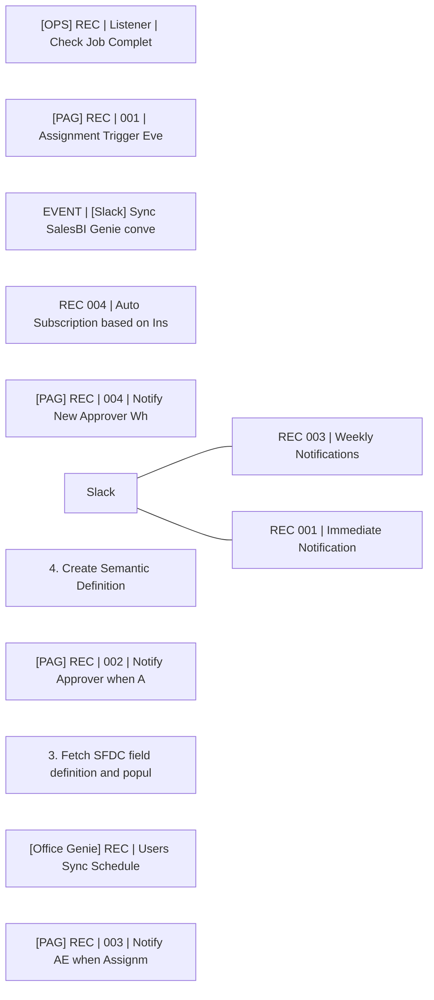

# Lineage — Recipes (PROD)

_Generated by estate-architect 2026-10-12 from the corpus index (heuristic edges from recipe descriptions; verify before acting)._
55 recipes in folder, 70,052,270 lifetime tasks total. Top recipes by task load:

- [[OPS] REC | Listener | Check Job Completion](https://app.workato.com/recipes/72253397) — 69,077,015 tasks, ok=38,303/fail=10,954, last_run=2026-04-24 (index last_run UNVERIFIED for running recipes)
- [[PAG] REC | 001 | Assignment Trigger Event](https://app.workato.com/recipes/68435056) — 669,162 tasks, ok=559,568/fail=43, last_run=2026-08-31
- [EVENT | [Slack] Sync SalesBI Genie conversation to Snowflake on Process stopped event](https://app.workato.com/recipes/59123531) — 85,661 tasks, ok=83,411/fail=28, last_run=2025-03-12 (index last_run UNVERIFIED for running recipes)
- [REC 004 | Auto Subscription based on Insights](https://app.workato.com/recipes/67018072) — 85,218 tasks, ok=355/fail=0, last_run=2025-10-22 (index last_run UNVERIFIED for running recipes)
- [[PAG] REC | 004 | Notify New Approver When Request Transferred by Manager](https://app.workato.com/recipes/68435059) — 22,591 tasks, ok=5,648/fail=0, last_run=2026-05-14
- [REC 003 | Weekly Notifications](https://app.workato.com/recipes/67018071) — 16,448 tasks, ok=50/fail=0, last_run=2025-12-08 (index last_run UNVERIFIED for running recipes)
- [4. Create Semantic Definition](https://app.workato.com/recipes/58115304) — 15,045 tasks, ok=579/fail=158, last_run=2025-01-16 (index last_run UNVERIFIED for running recipes)
- [[PAG] REC | 002 | Notify Approver when Assignment Created](https://app.workato.com/recipes/68435057) — 11,061 tasks, ok=5,371/fail=1, last_run=2026-05-14
- [REC 001 | Immediate Notification](https://app.workato.com/recipes/67018070) — 10,055 tasks, ok=135/fail=1, last_run=2026-04-10 (index last_run UNVERIFIED for running recipes)
- [3. Fetch SFDC field definition and populate data tables](https://app.workato.com/recipes/58115303) — 9,087 tasks, ok=1,145/fail=0, last_run=2025-01-17
- [[Office Genie] REC | Users Sync Scheduler](https://app.workato.com/recipes/68402278) — 7,794 tasks, ok=7,791/fail=9, last_run=2025-12-14 (index last_run UNVERIFIED for running recipes)
- [[PAG] REC | 003 | Notify AE when Assignment Request Approved by Manager](https://app.workato.com/recipes/68435058) — 7,268 tasks, ok=3,595/fail=0, last_run=2026-05-14

