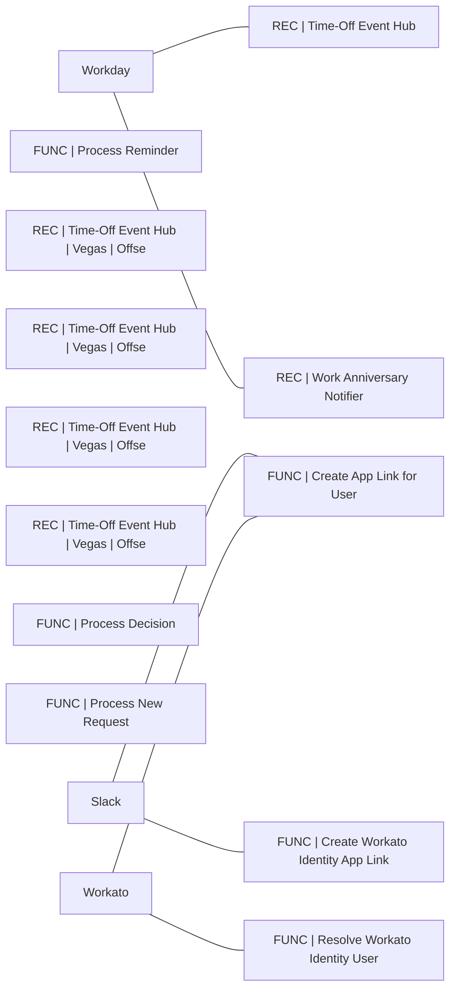

# Lineage — PTO (DEV)

_Generated by estate-architect 2026-10-12 from the corpus index (heuristic edges from recipe descriptions; verify before acting)._
19 recipes in folder, 29,262,492 lifetime tasks total. Top recipes by task load:

- [REC | Time-Off Event Hub](https://app.workato.com/recipes/74094662) — 11,980,668 tasks, ok=20,886/fail=1,111, last_run=2026-10-10 (index last_run UNVERIFIED for running recipes)
- [FUNC | Process Reminder](https://app.workato.com/recipes/74248295) — 8,083,140 tasks, ok=4,028,597/fail=22,137, last_run=2026-10-10 (index last_run UNVERIFIED for running recipes)
- [REC | Time-Off Event Hub | Vegas | Offset 2m](https://app.workato.com/recipes/82531435) — 1,728,076 tasks, ok=4,262/fail=172, last_run=2026-10-05
- [REC | Time-Off Event Hub | Vegas | Offset 4m](https://app.workato.com/recipes/82531440) — 1,727,682 tasks, ok=4,261/fail=171, last_run=2026-10-05
- [REC | Time-Off Event Hub | Vegas | Offset 1m](https://app.workato.com/recipes/82531434) — 1,727,297 tasks, ok=4,260/fail=172, last_run=2026-10-05
- [REC | Time-Off Event Hub | Vegas | Offset 3m](https://app.workato.com/recipes/82531437) — 1,726,864 tasks, ok=4,259/fail=174, last_run=2026-10-05
- [FUNC | Process Decision](https://app.workato.com/recipes/74247862) — 1,104,836 tasks, ok=382,345/fail=97, last_run=2026-10-05 (index last_run UNVERIFIED for running recipes)
- [FUNC | Process New Request](https://app.workato.com/recipes/74247462) — 565,707 tasks, ok=282,398/fail=41, last_run=2026-10-05 (index last_run UNVERIFIED for running recipes)
- [FUNC | Create App Link for User](https://app.workato.com/recipes/74253452) — 278,759 tasks, ok=89,936/fail=4, last_run=2026-10-06 (index last_run UNVERIFIED for running recipes)
- [FUNC | Resolve Workato Identity User](https://app.workato.com/recipes/82252756) — 94,360 tasks, ok=47,180/fail=2, last_run=2026-09-11 (index last_run UNVERIFIED for running recipes)
- [FUNC | Create Workato Identity App Link](https://app.workato.com/recipes/82262986) — 88,918 tasks, ok=44,459/fail=2,058, last_run=2026-09-16 (index last_run UNVERIFIED for running recipes)
- [REC | Work Anniversary Notifier](https://app.workato.com/recipes/74380245) — 78,067 tasks, ok=78/fail=6, last_run=2026-10-05 (index last_run UNVERIFIED for running recipes)

