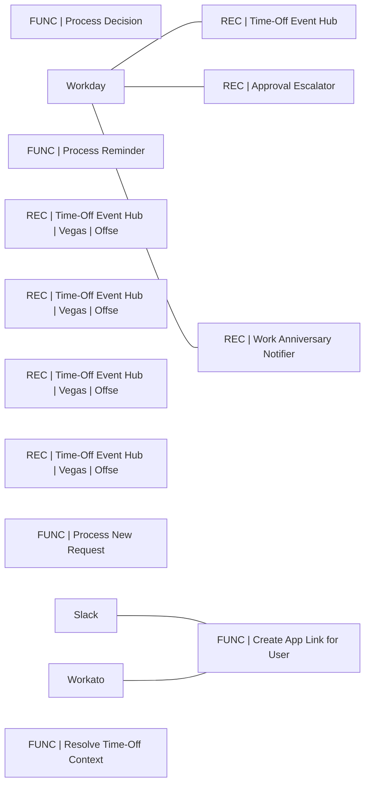

# Lineage — PTO (PROD)

_Generated by estate-architect 2026-10-12 from the corpus index (heuristic edges from recipe descriptions; verify before acting)._
15 recipes in folder, 100,590,845 lifetime tasks total. Top recipes by task load:

- [FUNC | Process Decision](https://app.workato.com/recipes/82120566) — 25,290,692 tasks, ok=8,596,626/fail=773, last_run=2026-09-09 (index last_run UNVERIFIED for running recipes)
- [REC | Time-Off Event Hub](https://app.workato.com/recipes/82120571) — 24,569,282 tasks, ok=8,806/fail=59, last_run=2026-09-09 (index last_run UNVERIFIED for running recipes)
- [FUNC | Process Reminder](https://app.workato.com/recipes/82120568) — 11,093,223 tasks, ok=5,543,898/fail=928, last_run=2026-09-09 (index last_run UNVERIFIED for running recipes)
- [REC | Time-Off Event Hub | Vegas | Offset 4m](https://app.workato.com/recipes/82641528) — 8,989,026 tasks, ok=2,678/fail=15, last_run=2026-10-10 (index last_run UNVERIFIED for running recipes)
- [REC | Time-Off Event Hub | Vegas | Offset 3m](https://app.workato.com/recipes/82641527) — 8,972,034 tasks, ok=2,673/fail=23, last_run=2026-10-10 (index last_run UNVERIFIED for running recipes)
- [REC | Time-Off Event Hub | Vegas | Offset 1m](https://app.workato.com/recipes/82641525) — 8,959,783 tasks, ok=2,668/fail=126, last_run=2026-10-10 (index last_run UNVERIFIED for running recipes)
- [REC | Time-Off Event Hub | Vegas | Offset 2m](https://app.workato.com/recipes/82641526) — 8,936,125 tasks, ok=2,664/fail=98, last_run=2026-10-10 (index last_run UNVERIFIED for running recipes)
- [FUNC | Process New Request](https://app.workato.com/recipes/82120567) — 3,561,983 tasks, ok=1,778,354/fail=890, last_run=2026-09-09 (index last_run UNVERIFIED for running recipes)
- [FUNC | Create App Link for User](https://app.workato.com/recipes/82120565) — 58,858 tasks, ok=19,866/fail=0, last_run=2026-10-10 (index last_run UNVERIFIED for running recipes)
- [REC | Approval Escalator](https://app.workato.com/recipes/82120570) — 54,320 tasks, ok=10,681/fail=15, last_run=2026-09-05 (index last_run UNVERIFIED for running recipes)
- [REC | Work Anniversary Notifier](https://app.workato.com/recipes/82120572) — 38,055 tasks, ok=36/fail=1, last_run=2026-09-08 (index last_run UNVERIFIED for running recipes)
- [FUNC | Resolve Time-Off Context](https://app.workato.com/recipes/82120569) — 18,892 tasks, ok=3,446/fail=966, last_run=2026-10-10 (index last_run UNVERIFIED for running recipes)

