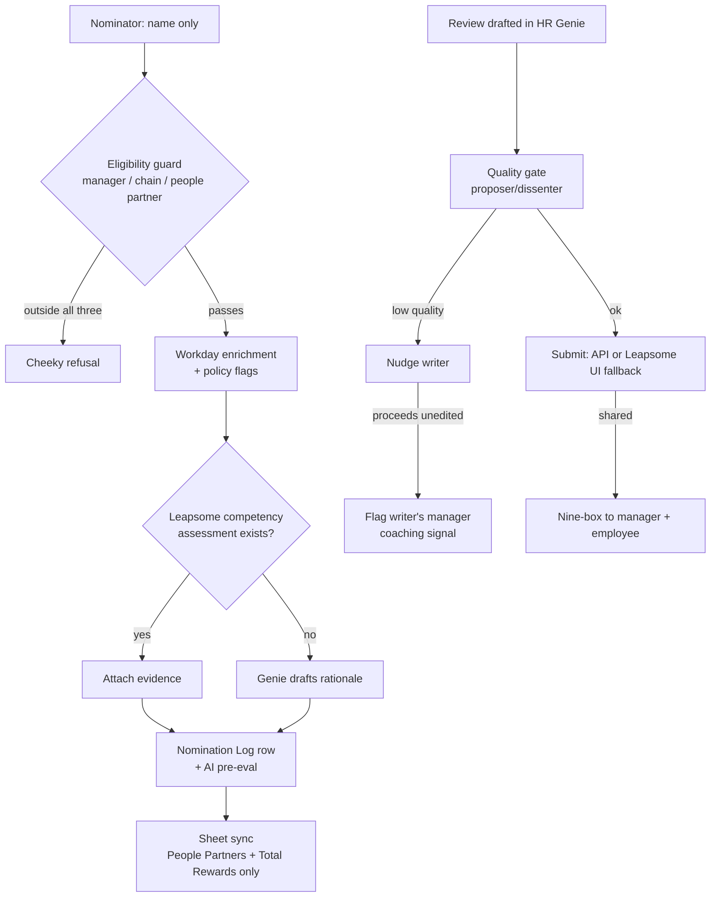

# BSYS-29730 — Technical plan: HR Genie Annual Performance Review Cycle

Epic: https://workato.atlassian.net/browse/BSYS-29730 (13 pts, Backlog)
Source: kickoff digest `Workday-Development/docs/hr-genie/perf-review-cycle/REQUIREMENTS-digest-kickoff-2026-10-15.md` (R1–R7)
Plan date: 2026-10-18 (jira-triage pass), revised after dissenter review same day. Status: plan ready — awaiting Josh's authorization to kick off.

## Live estate facts grounding the plan

- HR Genie is live: `gin-AYbxpMha-YenKAJ-CD`, state started, 27 skills, 1 KB, JSM escalation wired. New cycle skills attach to this genie.
- **The surface being replaced already exists and must be dispositioned:** Performance Management Genie v2 (`gin-AaD4awRp-4xXomC-CD`, 17 skills, started per 2026-10-08 estate discovery) runs 13 Leapsome API skills in AHQ | AI Development (ws 3535597) — `Get Reviewee Overview` 73290823, `List Review Cycles` 73290820, `List Review Participants` 73290822, `List Employees` 73291906 (tracker-verified 2026-10-18). R2's decision is consolidation INTO HR Genie. This plan reuses those proven API paths rather than building a fresh adapter, and freezes then retires the v2 surface at cutover.
- Leapsome connectivity spans three workspaces: custom connector `leapsome_connector_748504`; `[PER] Leapsome` conn 19217970 (AHQ | AI Production ws 3535598, authorized 2026-04-07) with 4 consumer recipes; `Leapsome (SCIM)` 1260155 (AHQ | BT Development) / 1260488 (AHQ | BT Production); and a dev connection 19006083 in the build workspace that **reads PRODUCTION Leapsome (1,380 employees) — masked handling from day one**.
- Workday backend: conn 19760013 (SOAP/WQL) reads the **wd108 IMPL tenant — dev org data is demo-grade, so dev-era eligibility checks and enriched rows are indicative only; eligibility guard and people-partner data get validated against prod ISU reads at promotion**, per the 2026-10-06 OOO-dispute close. REST side: 19218617.
- Workday migration off Leapsome lands in ~6 months (R6) — Leapsome-specific code stays isolated behind the reused skill family.

## Deadlines (R7 + FY27 doc, anchored)

Dev-UAT + guidelines by **Nov week 1**; **December cycle launch**. Four weeks from 10-18 lands ~Nov 15 — over. Compression: spikes fire day 1–2; R1 lands end of week 1; UAT cohort prep (Brittany/Justin) runs parallel from week 2, not after. If spikes or permission work slip, the honest move is descope to R1+R5 for the December cycle and run R2–R4 as a fast-follow — Josh decides that if it comes to it.

## Architecture (per kickoff digest R1–R5)

All new assets live in the HR Genie project (root 30275122), a new `Perf Review Cycle` folder. Surface is HR Genie in Slack (conversational; no Slack forms — R6 accepted).

**Shared foundation (build first)**
- `TBL | Perf Cycle | Nomination Log` — one row per nomination: nominee, nominator, Workday-enriched fields, policy flags, competency-attach ref, AI pre-eval verdict, sheet-sync state. **No-read/no-list contract: no genie skill reads this table beyond the caller's own rows** — otherwise any employee could ask the Genie to enumerate nominations and bypass the Sheet ACL entirely.
- `TBL | Perf Cycle | Review Shared Watermark` — Leapsome events consumed with the inclusive-watermark guard (pattern proven in BSYS-29477).
- `TBL | Perf Cycle | Quality Gate Verdicts` — draft hash, rubric scores, nudge sent, manager-flag sent.
- Leapsome access via existing connection 19006083 (build workspace) behind the reused skill family; no new connector, no new ISU request unless the prod-side read needs one at promotion.

**R1 Promotion nominations (replaces the Google Form)**
1. Skill on HR Genie: "Promote someone" — nominator enters only the nominee's name.
2. `FUNC | Workday Nominee Enrichment` — name → worker ID; pulls title, level, time in role, division, cost center owner, assigned people partner (multi-valued), direct reports. IMPL-tenant caveat above applies in dev.
3. `FUNC | Nomination Eligibility Guard` — three branches: nominator has direct reports, OR sits in the nominee's management chain (WQL sub-org), OR **is the nominee's assigned people partner** (the same multi-valued field the Sheet column uses — without this branch Julie gets refused, which contradicts the digest). Recommend-not-block: cheeky refusal for everyone outside all three; flags never block.
4. Policy flags computed at intake: tenure vs 12–24 months, rating vs "exceeds expectation". Flags ride the row.
5. Competency assessment: when the manager completed one in Leapsome, attach its **overview-answer evidence** (the `/competencies` endpoint 404s — undocumented). Attach mechanics = **Spike C** (what concretely lands on the Sheet row: link, extracted text, file — the old form mandated a PDF; AC-4 rides on this).
6. `REC | Nomination Sheet Sync` — appends to the calibration Google Sheet: partner column, AI pre-eval column (fusion verdict: strength + flags). Suggested next level proposed by the Genie; laterals/reorgs route to Jo.

**R2 Review drafting (+ Spike A)**
- Skill: "Draft my review" — pulls cycle, reviewee, prior reviews from Leapsome via the reused v2 skill paths.
- **Spike A (Josh, gates the submit path only):** Leapsome API submit. Fallback = manager clicks submit in Leapsome, documented as a known limitation.
- Keep every Leapsome call inside the one reused skill family so the ~6-month Workday migration swaps one layer.

**R3 Quality gate ("the sniffer")**
- `GENIE-pair | Quality Gate` — proposer/dissenter fusion: fact-check, personalization, quantified impact, rating calibration ("not too harsh, not too easy"), rubric fed by Workato's own review-writing guidance.
- Writer gets the nudge; if they proceed unedited, the writer's manager gets a coaching-signal flag. Never a block.
- "Proceeded unedited" detection has two paths by Spike A's verdict: same draft hash resubmitted through HR Genie (submit works), or — fallback path — the Review Shared Detector compares the Leapsome-submitted content against the gated draft hash. Both stated up front so AC-8 doesn't hinge on the spike.

**R4 Nine-box delivery**
- `REC | Review Shared Detector` — polls Leapsome for shared reviews. **Open item D (gates AC-7): the exact "shared" signal is unconfirmed — Phase 0 found signatureManager/signatureReviewee populate per-reviewee and ≠ completion. Needs People-team confirmation before the detector's semantics are final.**
- Delivery: **pass Leapsome's own nine-box file attachment through Workato into Slack first** (digest line 34, the thin path). A from-data renderer is the fallback only if Spike B proves the attachment mechanics fail — and note the renderer's "potential" axis was never shown to exist in the API (Phase 0 found 3-point text labels and 0–100 question averages only). No renderer gets built before either fact is in hand.
- Delivered to BOTH manager and employee with the plain-English explanation.

**R5 People-partner surface**
- Sheet stays. Access scoped to People Partners + Total Rewards (Miley, Sahin, Julie); one owner holds sharing. **Open item E: name the live calibration Sheet (ID) and its sharing owner before sheet-sync build.**
- Write identity: workspace-owned bot/service connection per the standing rule — end-user credentials never in long-running integrations (Consumer Endpoints bot precedent).
- Dev/UAT writes go to a **copy** of the calibration Sheet; the live sheet is touched only at cutover.
- Submitters can never enumerate other rows: nominations enter via the Genie (caller-scoped table contract above) and are read only through the Sheet ACL.
- Exec visibility stays an open question for Jo — ships without, grants later if yes.

**Privacy + observability posture (new recipes and the AI pipeline)**
- Review drafts and promotion rationales are the most sensitive content HR Genie has handled. The Intelligence Platform collector (82862205, Running) ingests HR Genie conversations, and the nightly Quality Judge (82863299) sends transcripts to an external model (gpt-4o-mini). Decision needed at kickoff (Josh): whether perf-cycle conversations get a registry tier change, exclusion from external-LLM judging, or special retention. Default posture until decided: same pipeline, redaction as-is, flagged in UAT evidence.
- New recipes emit App Event Ledger instrumentation per the estate's total-observability doctrine.

## Open items mapped (none blocks kickoff; two gate mid-build items)

| Item | Owner | Design posture |
|---|---|---|
| Exec Sheet visibility | Jo | Ship without; grant later if yes |
| Lateral/reorg nominations | Jo | Route-to-Jo path built, cheap either way |
| Leadership-support question | Jo | Drop-in/routable field, one column swap |
| Leapsome API submit | Josh (Spike A, day 1) | Gates R2 submit path only; R3 has both detection paths |
| Workday people-partner scopes | Josh (permission work) | R1 enrichment ships without the partner column if scopes land late; column backfills — noted, not hidden |
| Attachment → Slack mechanics | Josh (Spike B, day 1) | Gates R4 renderer-vs-passthrough choice |
| Competency attach mechanics | Josh (Spike C, day 1) | Gates R1 step 5 shape |
| Exact "shared review" signal | People team (open item D) | Gates R4 detector semantics (AC-7) |
| Calibration Sheet ID + sharing owner | Josh/Jo (open item E) | Gates sheet-sync build start |

## Phasing (compressed to the Nov week 1 / December launch anchors)

- Day 1–2: spikes A, B, C fired; open item D and E raised.
- Week 1: foundation tables + R1 enrichment/eligibility (three-branch guard) + sheet sync; UAT cohort prep starts in parallel.
- Week 2: R2 drafting + R3 quality gate.
- Week 3: R4 nine-box + end-to-end wiring + ledger instrumentation.
- Week 4: UAT with the mixed cohort (managers, non-US, CS, Treaty) + checkpoint testing per phase.
- Dev/test surface: BT AI Slack workspace (pre-prod HR Genie features). Promotion is a separate governed batch (manifest, red-team gate, DR story).

## Points

Epic carries 13. Suggested story split summing to it: 4 (R1 nominations + enrichment + sheet sync), 3 (R2 drafting + spike A disposition), 3 (R3 quality gate), 2 (R4 nine-box + spikes B/D), 1 (R5 sheet hardening) — filed as children at kickoff, not before.

## Risks

- Workday migration (~6 months) makes some Leapsome work throwaway — mitigated by reusing the v2 skill family and the thin-adapter rule; nine-box is the most Leapsome-coupled and is now passthrough-first.
- Sheet holds nominee PII and performance data — masking, ACL proof, and the no-read contract are UAT rows, not afterthoughts.
- External-LLM judging of review content is a live privacy decision — flagged at kickoff, not discovered at UAT.
- Leapsome API surface is partly login-gated in docs; three spikes exist because three mechanics are unverified.
- Schedule is tight against Nov week 1; descope line drawn above if it slips.
- IMPL-tenant dev data is demo-grade; real-data validation happens at promotion with prod ISU reads.

## UAT evidence (will be recorded)

Per-story: job traces + table rows for a full nomination flow; eligibility refusal case (all three branches); policy-flag row landing in the Sheet with correct partner column; quality-gate nudge + manager flag on an unedited low-quality draft (both spike-A paths exercised as far as the verdict allows); nine-box delivery to both parties on a shared review; Sheet ACL proof (submitter cannot enumerate rows); Leapsome submit spike verdict (works, or documented fallback); masking + privacy-posture confirmation for review content.

## Acceptance criteria

The epic's own checkbox list (9 items) is adopted verbatim as the story-level AC set; evidence recorded under this file's section above.

## Flowchart (draft, for the sign-off meeting — not yet rendered)

## PRIVACY RULING (Josh, 2026-10-22 — unblocks week-1)

External-LLM judging of review content is GREENLIT: "We already use genies
which call external models today for HR Genie and our corporate accounts are
secured and privacy safe. Managers already use Claude today to help write
review. External LLM is greenlight." The open judgment from the plan is
resolved; do not re-gate on it. Remaining kickoff inputs: People team
shared-signal confirmation + calibration Sheet ID/owner.

## BUILDER E DELIVERY (2026-10-23, phase 2 proactive delivery slice)

Assets (dev ws 3535597, folder 35947367, delivered STOPPED — activates at UAT wiring):
- `Notification Ledger` data table 164257 (d0579d9e-eb71-4b00-ab6a-426b5852c2c9) — 9 cols, dedup_key REQUIRED, format `ninebox:{cycleId}:{userId}` (nudge rows will use `nudge:{date}:{managerId}`).
- `ninebox_share_watcher` recipe 83296504 — hourly; idle stop when no active cycle; fail-closed stop when active cycle lacks `config_key=leapsome_cycle_id`; share gate = `managers[0].status==complete AND signatureManager present`; dual notify via FUNC 74094657 (notify mode, bold-label summary + averageRating, no grid — potential axis does not exist in the API); append-style ledger rows, failed retried next run via missing sent row.
- Verified: force-run job `j-Ac6Yxwea-mggdB6-CD` (idle exit, clean stop with reason); ledger write path proven by manual insert + read-back then deleted (0 rows at delivery).

UAT-wiring checks (assumptions, not facts): Leapsome `page=`/`pageSize=200` contract; `/employees` row shape `_id/email/fullName`; per-run count queries cap 1000; share-signal semantics = open item D.

Recipe-builder gotchas validated this build (reusable):
- `set_condition` rhs values are taken LITERALLY — pass `complete`, never `'complete'` (quoted rhs compiles to a never-matching string compare).
- `.count`/`.size` are REJECTED in ruby() expressions, but `.size` datapills exist on list/records outputs — count via size pills or ledger queries (`sent_at >= scheduled_time` from the clock trigger pill), not ruby.
- `.where({'k' => bindings.v})` VALIDATES and works in recipe formulas (reconfirmed).
- Inline literal lists are NOT valid foreach sources — declare a list + `insert_to_list_batch` first; its `name` field wants picklist option ids, `location` is `end`/`start` (not `bottom`).
- Squad-build start failure `account_id can't be blank` with `config_errors[[N, ...]]`: N indexes the recipe CONFIG array — the custom-connector entry there needs its `account_id` patched via raw PUT (AIRO select_connections doesn't persist).
