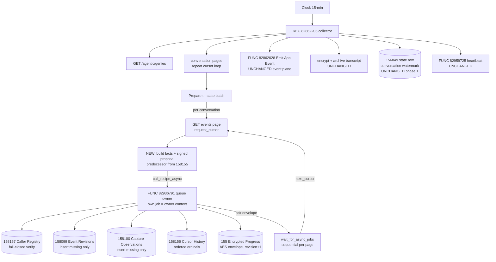

# PAGE-COMMIT CUTOVER SPEC — HR Genie telemetry collector → BSYS-29498 architecture

Written 2026-10-11 from live asset reads (dev ws 3535597). Read-only spec; no asset was
modified. Dev only. Everything below cites the recipe read of the named asset (all step
uuids are the first 8 hex of the real step uuid in the recipe's code tree).

Assets in play (all in dev folder 35712141 "Intelligence Platform", project 15643451):

| Asset | ID | State |
|---|---|---|
| REC \| HR Genie \| Conversation Event Collector | 82862205 | RUNNING, v30, 15-min clock |
| FUNC \| HR Genie \| Commit Collector Page (queue owner) | 82936791 | STOPPED, 10 assets, acceptance-proven |
| FUNC \| HR Genie \| Persist Agent Studio Event Facts | 82933117 | STOPPED, inner fact writer (TEST lane) |
| FUNC \| HR Genie \| Persist Conversation Metadata Facts | 82928715 | STOPPED |
| FUNC \| HR Genie \| Get Conversation Metadata Snapshot | 82928666 | STOPPED |
| FUNC \| HR Genie \| Read Scoped Agent Metadata Page | 82921350 | STOPPED |
| FUNC \| HR Genie \| Read Complete Agent Metadata | 82919662 | STOPPED |
| TEST \| Queued Checkpoint Owner Acceptance | 82939872 | stopped, calls 82936791 async ×3 |
| TEST \| Metadata Source Coverage Contract | 82921056 | stopped, read-only |
| TEST \| Agent Metadata API Capability | 82921534 | stopped, writer 82933117 harness |
| TEST \| Native Run and Feedback Metadata | 82929715 | stopped, writer 82933117 live-source |
| HR Genie Encrypted Collector Progress v1 | 158155 | 15 cols; 5 TEST residue rows |
| HR Genie Collector Cursor History v1 | 158156 | record_key/identity_hash/cycle_id/cursor_digest/ordinal |
| HR Genie Collector Caller Registry v1 | 158157 | 9 cols; exactly 1 row (TEST_FIXTURE, see below) |
| Conversation Metadata Facts v1 | 158030 | 36 cols (metadata lane, not this cutover) |
| Agent Studio Event Revisions v1 | 158099 | fact table (revision grain) |
| Agent Studio Capture Observations v1 | 158100 | fact table (observation grain) |
| HR Genie \| Telemetry Collector State | 156849 | collector's own state row (stays) |
| HR Genie \| Topic Taxonomy | 156850 | classification source (stays) |
| App event ledger emitter | 82862028 | untouched |
| FUNC \| Record Pipeline Heartbeat | 82959725 | untouched |

---

## 1. CURRENT-STATE MAP — collector 82862205 (what runs today)

Clock trigger, every 15 minutes (`scheduled_event`, time_unit=minutes). One job = one
drain cycle. Ad-hoc HTTP via custom Workato-API connector (connection 13685697) against
`www.workato.com/api/agentic/...`.

Top-level sequence (step uuid prefixes):

1. `a12ad9ce` get_records **156849** (Telemetry Collector State), filter
   collector_key='conversation_events', limit 1 → the collector's own state row.
2. `a47aafcd` HTTP GET /api/agentic/genies → `8b318c28` Ruby **"Resolve genie and
   window"**: find genie by name "HR Genie" → handle; `from_t = last_wm + 1s` (BSYS-29477
   inclusive-filter offset); 6-hourly resweep (hours 00/06/12/18 UTC) widens window to
   7 days (BSYS-29488 late-event resweep; emitter's ALREADY_PERSISTED dedup makes replay
   a no-op); returns genie_handle, from_iso, state_record_id, counters, last_wm,
   resweep_active.
3. `c290439e`–`16058578`: NINE declare_list slots (conv_cursor_slot, event_cursor_slot,
   conv_pages, event_pages, ack_flags, skip_flags, page_payloads, evt_work, round_flags)
   — the proven list-carried loop-state idiom (Variables-in-loop updates do not persist).
4. `90465304` repeat — **conversation-page pagination**: `3635769d` List conversations
   (cursor paginated), `a674e062` cursor-cycle guard (CONVERSATION_CURSOR_CYCLE),
   `75489cbd` if rows>0 → `69b43d1e` insert page JSON into page_payloads, cursor slot
   clear+insert, while cursor present.
5. `c5243b4e` Ruby **"Prepare conversation batch"**: flatten pages → drop
   `test_conversation=="true"` rows; tri-state scope per row (explicit "false"→LIVE,
   blank→UNKNOWN); max_created_iso, fresh_count.
6. `2660ebf9` get_records **156850** (Topic Taxonomy, active, limit 100) → classification
   source. `403a41f6` ensure_dir_exists redacted-transcripts/<env>.
7. `0b192200` if batch_size>0 → `8e1a01a3` foreach conversation:
   - `2a45a2c0` try: `5cac56d7` List conversation events (per conversation, cursor
     paginated), `c9c3e2d9` Event page overflow guard (non-blank next_cursor → enqueue
     into evt_work instead of failing), `b8736adc` if continuation → `96d0e553` enqueue;
     `57e7ebda` Ruby **"Mask, classify, fingerprint, build emits"** (mask EMAIL/SSN/WID,
     classify vs taxonomy, fingerprint, build ledger emit payloads).
   - catch `2cb385f0`: `dc75c55d` "Note skipped conversation" — 404/gone ⇒ skip
     (permanent), anything else re-raises (transient ⇒ job fails, watermark holds).
   - `09606789` Ruby encrypt transcript AES-256-GCM (key = project property
     **HR Genie Transcript Key**), `45ac3a01` store_file …/<session_hash>.txt.enc.
   - `75d93d7f` foreach emit → `4f4b43d1` call_recipe **82862028** (Emit App Event) →
     `4ccb17a5` verify durable emitter ack (PERSISTED/ALREADY_PERSISTED only) →
     `0213db4e` ack flag.
8. `67b41922` repeat (max 5 rounds) — **event-continuation round drain**: `99363a17`
   Round snapshot and budget → foreach pending conversation → `b518af13` fetch next event
   page, `5171577f` Round page guard, `b076688a` Round mask/classify, `2f7abc74` Round
   encrypt, `862adc81` store_file (round-suffixed), `7554abdc` foreach emit → 82862028 →
   ack verify; requeue; while evt_work non-empty.
9. `84261041` Ruby **"Residual overflow guard"**: any real continuation cursor left
   after the 5-round budget ⇒ raise EVENT_PAGE_OVERFLOW_UNHANDLED (checkpoint never
   runs ⇒ watermark holds; next cycle replays idempotently).
10. `a2b1cc3e` Ruby **"Compute checkpoint"**: monotonic new_wm (never regress), counters
    += fresh (minus skipped) / persisted acks.
11. `76e16f56` update_record **156849** — write new watermark + totals (inside the if
    block; only on a fully-proven cycle). `b18a920f` update_record **156849** —
    last_run_at=now, UNCONDITIONAL (liveness decoupled from progress).
12. `69e5505e` try → `46e22e76` call_recipe **82959725** (Record Pipeline Heartbeat,
    component_key=collector-conversation-events), catch swallows.

Key facts: ALL persistence today is ledger events (82862028) + the single state row
(156849) + encrypted transcript files. The collector is its own pager, its own
checkpoint-verifier (only via "did every emit ack"), and its own watermark writer.
Tables 158099/158100/158155/158156/158030 are written by NOTHING except the
acceptance tests today.

---

## 2. TARGET TOPOLOGY — what the page-commit architecture is

**Commit Collector Page 82936791 IS the queue owner.** Its own description says
"asynchronous queue owner"; the acceptance test's fixture module pins
`OWNER_ID = '82936791'`. There is no separate owner/queue recipe, and none is needed.

Caller vs owner (from the registry guard's runtime bindings, step `2b2111fd`):

- `caller_recipe_id` = `execute.context.calling_recipe_id` — the recipe that directly
  invoked the function. Runtime-derived; can NEVER be spoofed by an input.
- `owner_recipe_id` = `job_context.recipe_id` — the recipe id in whose job context the
  function executes.
- The guard **requires caller != owner**. Therefore the call MUST be asynchronous:
  `call_recipe_async` gives the function its own job (job_context.recipe_id = 82936791),
  so caller=82862205, owner=82936791. A synchronous `call_recipe` from the collector
  would inherit the collector's job context (caller == owner == 82862205) and fail
  closed with COLLECTOR_CALLER_NOT_REGISTERED. This is exactly why the acceptance test
  uses `call_recipe_async` + `wait_for_async_jobs` (timeout=1) and asserts
  `async_join_verified` + job_succeeded_count==1, job_failed_count==0.

**How queued checkpoint ownership serializes:** each async commit job is a private,
self-verifying checkpoint transition. There is no lock/CAS and no queue table;
serialization is caller-side and STRICTLY SEQUENTIAL — the collector must await each
page's commit (`wait_for_async_jobs`) before building the next page's proposal, because
each proposal must carry the predecessor revision + predecessor envelope produced by the
previous commit (proposal chain: predecessor_revision/predecessor_envelope). Replays are
safe: the commit re-reads PRE state and inserts only missing rows (duplicate writes are
counted, not duplicated), so at-least-once invocation with sequential await is the
correct contract.

**What one commit actually does (82936791, in order):**
1. `2c5b8770` get_records **158157** (Caller Registry) filtered caller == calling id,
   owner == job_context.recipe_id, capture_scope == parameter; limit 2 — a non-empty
   query continuation token ⇒ ambiguity ⇒ fail.
2. `2b2111fd` Ruby guard — exactly 1 row; row fields UTF-8 ≤128 bytes; owner != caller;
   environment (property-derived, normalized dev/prod) matches row;
   source_namespace='AGENT_STUDIO'; scope in LIVE/TEST; role in
   [CONVERSATION_COLLECTOR, TEST_FIXTURE]; is_enabled true; registry_version == 1;
   TEST_FIXTURE requires scope TEST; record_key must equal
   SHA256(JSON(["HR_GENIE_COLLECTOR_CALLER_REGISTRY_V1", env, caller, owner,
   "AGENT_STUDIO", scope, role])). Else raise COLLECTOR_CALLER_NOT_REGISTERED.
3. `0790b0ca` Ruby projector — validates the WHOLE immutable event page (facts_json:
   raw source events; allowlist llm_call_completed / genie_run_start / genie_run_finish /
   user_feedback / user_message; unknown types counted as finite_owner_skip, not failed),
   HMAC-identifies with salt/salt_epoch properties (genie_hmac, conversation_hmac,
   capture_job_hmac), validates conversation ownership against expected_conversation_id
   and environment against the property. No raw ids or text ever persisted — hash-only.
4. `7765c61a` Ruby — authenticates the signed checkpoint proposal (HMAC(salt) over the
   proposal tuple incl. request_cursor, next_cursor, terminal == (next_cursor nil),
   page_ordinal, page_digest, source_body_hmac) and derives the private progress
   identity: query_fingerprint = SHA256 over the FIXED tuple
   ['HR_GENIE_AGENT_EVENT_QUERY_V1', env, ns, scope, salt_epoch, genie_hmac,
   conversation_hmac, 'ALL_EVENT_TYPES', 'asc', 100] — i.e. **one progress stream per
   conversation**; identity_hash = record_key = SHA256(env, ns, scope, fingerprint).
5. `6b3a6cc9` get_records **158155** (progress) by record_key → `3d92d6` verify the
   encrypted predecessor BEFORE any fact write (proposal's predecessor_revision/envelope
   must match durable state).
6. Cursor-history PRE phase (`c25daedf` foreach + `af9830cb` repeat paging get_records
   **158156** by identity_hash + cycle_id) — verify the ordered ACTIVE/PENDING history
   chain, `c22a369b` verify complete encrypted predecessor history.
7. Fact PRE/POST phases: page 158099 (by conversation_hmac) and 158100 (by
   capture_job_hmac) → SQL list compare (expected vs PRE) → insert only MISSING rows via
   create_records_batch → re-read → `8a4dfdc0` require complete canonical POST match
   before any durable page ACK.
8. `7d4f2205` Ruby plan: write_mode CREATE|UPDATE; ordered cursor-history inserts
   (ordinal, cursor_digest transitions); new encrypted progress envelope (AES, key from
   transcript key, stream kind COLLECTOR_PROGRESS_R<rev>) + progress_revision.
9. `85401d51` foreach → add_record **158156** (history rows) → re-read + POST-phase
   verify (`59c09e06`/`41f62850`/`91d2d73f`/`06bc3418`).
10. `ee53c587` if CREATE → `cf2b30dd` add_record **158155** else `4dca7426`
    update_record **158155**; `908c0a8f` re-read → `f3065828` verify exact authenticated
    encrypted progress readback.
11. `640e4a0b` return ack envelope: protocol_version, source_namespace, environment,
    salt_epoch, all HMACs, capture_scope, page_digest, page_ordinal, revision/observation
    counts, verified counts, pre/post duplicate counts, persisted, progress_committed,
    progress_revision, coverage, coverage_scope.

**Function input contract (7 inputs, all required):** facts_json (string),
expected_conversation_id (string), capture_scope (string LIVE|TEST), observed_at
(string), capture_cycle_hmac (64-hex), page_ordinal (integer), checkpoint_proposal_json
(string). Properties read inside: HR Genie Telemetry Pseudonym Salt, Salt Epoch,
Environment, Genie Handle. capture_job_id comes from execute.context.calling_job_id.

**Continuation token semantics:** the cursor chain travels inside
checkpoint_proposal_json as request_cursor → next_cursor (+terminal flag). Each commit
records the cursor transition as digest rows in 158156 (ordered by ordinal) and advances
the encrypted progress cursor in 158155. The registry read's own continuation token must
be empty (≤1 matching registry row).

**The four other functions are the metadata lane, not this cutover's caller surface:**
82919662 (complete bounded metadata cursor reader) → 82921350 (one scoped metadata page,
candidate state only) → 82928666 (owned conversation detail snapshot, pseudonymized) →
82928715 (persist SNAPSHOT+OBSERVATION metadata facts into 158030 with exact readback
ACK). 82933117 is the inner fact writer the TESTs call directly with TEST facts (no
registry guard). Proven by TESTs 82921534 / 82929715 / 82921056 respectively.



---

## 3. STEP-LEVEL CHANGE LIST — collector 82862205

Design principle: **additive fact lane + commit-owned event-page durability, minimal
displacement.** The ledger emit, transcript archive, conversation watermark, and
heartbeat are untouched in this cutover (they are the consumed event plane; the commit
writes facts, not ledger events).

MODE GATE (rollback kill switch, property-driven): wrap the new commit lane in an
`if` on project property **HR Genie Telemetry Mode** — value `PAGE_COMMIT` runs the new
lane; any other value (today: `ACTIVE`) runs the legacy path unchanged. Property names
are case-sensitive exact-match; set the value only after verification passes. (No AIRO
tool writes properties — `wt properties upsert --project 15643451` or the UI.)

### New steps (all inside the per-conversation foreach `8e1a01a3`, inside the existing try `2a45a2c0`)

Position after the event-page fetch (`5cac56d7`) + its guard (`c9c3e2d9`), BEFORE the
existing mask/classify step `57e7ebda` (order within try: fetch → commit → mask/classify
→ emit, so a commit failure holds everything):

- **N1 — Ruby "Read progress predecessor"** (new code step + a get_records 158155):
  compute the page identity from the fetched page (conversation_hmac = HMAC(salt,
  conversation_id), genie_hmac from property handle) using the CheckpointState/
  QueuedCheckpointOwner identity logic lifted verbatim from test 82939872's snippet
  (modules: CheckpointState, CheckpointCrypto, CollectorCallerRegistryGuard,
  AgentStudioEventFactProjector, AgentStudioEventNativePageWrapper,
  AgentStudioEventStoragePlan/Wrapper/Ack, QueuedCheckpointOwner,
  AgentStudioQueuedPageProposal — all present in 82939872's code step `b6487935` and
  designed to be lifted into a masked code step). Then get_records 158155 by record_key
  → predecessor_revision + predecessor_envelope (0/nil when absent).
- **N2 — Ruby "Build LIVE page proposal"**: AgentStudioQueuedPageProposal.build with
  raw_body = the raw page response JSON (data + next_cursor verbatim),
  capture_scope='LIVE', capture_job_id = job_context.job_id, observed_at = now ISO,
  parent_test_scope = per-conversation tri-state ('LIVE' when test_conversation=="false",
  'UNKNOWN' when blank — the batch already filters explicit test rows),
  capture_cycle_hmac = HMAC-SHA256(salt, JSON(["HR_GENIE_COLLECTOR_CAPTURE_CYCLE_V1",
  job_id])) — one capture cycle per collector run, page_ordinal = per-conversation
  ordinal within this run (0 for the first fetched page; +1 per continuation page),
  request_cursor = cursor this page was fetched with (nil for first), predecessor fields
  from N1. Output: facts_json, checkpoint_proposal_json, next_cursor, terminal.
- **N3 — call_recipe_async 82936791** with the 7 required inputs (facts_json,
  expected_conversation_id = conversation id, capture_scope='LIVE', observed_at,
  capture_cycle_hmac, page_ordinal, checkpoint_proposal_json).
- **N4 — wait_for_async_jobs** (job_ref from N3, timeout=1, same shape as test
  82939872 `f647315e`), then a small verify step: assert the async job succeeded and the
  ack envelope has persisted=true (or persisted=false with pre/post_duplicate counts —
  full-duplicate replay is success), progress_committed=true, coverage in
  [IN_PROGRESS, COMPLETE]. Any failure ⇒ raise (see failure semantics below).
- **N5 — continuation handling**: replace the current "if next_cursor → enqueue into
  evt_work" with: terminal pages (next_cursor nil) mark the conversation COMPLETE;
  non-terminal pages either (a) drain inline in a bounded repeat inside the
  conversation loop (preferred: page_ordinal chains naturally and no cross-iteration
  state is needed) with the SAME N1–N4 sequence per page, or (b) keep the existing
  evt_work 5-round queue with per-round N1–N4 calls. Choose (a) unless the inline repeat
  hits the platform's nested-repeat limitation (known trap: repeat bodies nested in
  foreach did not execute on this runtime — if so use (b) and derive page_ordinal from
  the round number). The residual overflow guard `84261041` is RETAINED either way.

### Modified steps

- `57e7ebda` / `b076688a` (mask/classify/build emits): UNCHANGED — still feeds the
  ledger emit foreach. (The commit validates the raw page itself; the emit lane keeps
  its own masking/classification.)
- `c5243b4e` Prepare conversation batch: UNCHANGED.
- `a2b1cc3e` Compute checkpoint: UNCHANGED in phase 1. The conversation watermark stays
  the discovery checkpoint; per-conversation event-page durability moves to 158155/158156
  (this is what makes an interrupted multi-page drain resumable from the progress row
  instead of relying on the 6-hourly resweep + emitter dedup — a phase-2 option, see
  Open Questions).
- NO changes to: trigger, state read `a12ad9ce`, genie resolve `8b318c28`, conversation
  pagination repeat `90465304`, taxonomy read `2660ebf9`, encrypt/archive
  (`09606789`/`45ac3a01`), emit foreach `75d93d7f`, watermark/last_run updates
  (`76e16f56`/`b18a920f`), heartbeat `69e5505e`.

### Commit-failure semantics (fail-closed, same philosophy as today)

- COLLECTOR_CALLER_NOT_REGISTERED or any guard/validation raise in the async job ⇒
  wait_for_async_jobs observes failure ⇒ collector RAISES (no skip). Watermark
  `76e16f56` never runs; last_run_at `b18a920f` still lands; next cycle replays the
  whole window idempotently (emitter dedup + commit missing-row selection make replay
  row-neutral). Registry/config errors are permanent and must page a human — do NOT
  add a retry counter that could mask them.
- Transient async failure (timeout/infra): same — raise and hold. No in-job retry loop
  in phase 1 (the 15-min cycle is the retry).
- Skipped (404-gone) conversations: unchanged — never reach the commit lane.
- Population law (agentic-platform-lessons): the phase gate MUST include per-run counts
  (pages fetched / commits acked / rows landed in 158099+158100), not just green paths.

---

## 4. CALLER REGISTRY — seed rows (exact field values)

Current state: table 158157 has exactly ONE row — the acceptance test's self-seeded
TEST_FIXTURE row (caller 82939872, owner 82936791, dev, TEST, TEST_FIXTURE, enabled,
v1). **The collector's LIVE row does NOT exist and MUST be seeded before cutover**;
with capture_scope='LIVE' passed by the collector and no matching row, the first commit
fails closed (by design).

Row to insert (dev) — record_key formula verified byte-exact against the live TEST row
(SHA256 over compact JSON, Ruby JSON.generate / python separators=(',',':')):

| Column | Value |
|---|---|
| record_key | `fe36b52671c811ab67d528d03d6bdacb09d90611c4558114e7aa3d99b967b012` |
| caller_recipe_id | `82862205` |
| owner_recipe_id | `82936791` |
| environment | `dev` |
| source_namespace | `AGENT_STUDIO` |
| capture_scope | `LIVE` |
| role | `CONVERSATION_COLLECTOR` |
| is_enabled | `true` |
| registry_version | `1` |

Insert path: `wt dt create` is not for data rows — use the data-tables record API
(`POST https://data-tables.workato.com/...` with `{"document": {<column_name>: value}}`
envelope) or the UI. No AIRO tool writes rows. Insert is a WRITE to a dev data table —
do it in the BUILD step, not now.

Registry discipline: exactly ONE enabled row per (caller, owner, env, scope, role)
tuple — the verifier fails on >1 match (limit 2 + continuation check). Never reuse the
TEST_FIXTURE row for the live lane.

New assets required: **none.** No queue-owner recipe (82936791 is the owner), no
helper recipe (the proposal builder lifts into a collector code step), no new tables.
Optional later asset: a per-conversation progress reader function for observability —
not needed for cutover (reads of 158155 are direct get_records).

### Property set the cutover reads (dev project 15643451, verified values)

| Property | Dev value | Read by |
|---|---|---|
| HR Genie Telemetry Environment | `Development` (guard normalizes → `dev`) | commit guard + projector |
| HR Genie Telemetry Pseudonym Salt | set (64 hex) | all HMACs |
| HR Genie Telemetry Salt Epoch | set | identity tuple |
| HR Genie Telemetry Genie Handle | `gin-AYbxpMha-YenKAJ-CD` | expected_genie_handle validation |
| HR Genie Transcript Key | set (64 hex) | progress envelope AES (collector reads it today for transcripts; the commit's progress crypto derives from it via the fixture's CheckpointCrypto key derivation — VERIFY the exact key-source binding in the build; the test passes transcript_key_hex explicitly) |
| HR Genie Telemetry Mode | `ACTIVE` → set to `PAGE_COMMIT` at cutover | NEW mode gate |

Note: the commit function reads `HR Genie Telemetry Genie Handle`, which was NOT in the
ticket's property list — it exists and is set. No property changes are needed except
Mode at flip time.

---

## 5. TEST PLAN

Existing proof (run as-is, all currently STOPPED — editor Test or force-run per asset
type; TEST recipes are functions, so Orca editor Test on the recipe page):

| Test | Proves |
|---|---|
| TEST 82939872 Queued Checkpoint Owner Acceptance | THE commit path: async ownership (caller≠owner), registry verify, 3-page chained checkpoint advance + empty-terminal page, predecessor chain, encrypted progress, exact readback, replay. Run FIRST — it is the contract witness. |
| TEST 82921534 Agent Metadata API Capability | metadata reader surface + capture-TEST immutable fact persistence/replay via writer 82933117 |
| TEST 82929715 Native Run and Feedback Metadata | writer 82933117 against a real source-owned conversation; first/replay/zero ACKs |
| TEST 82921056 Metadata Source Coverage Contract | read-only metadata coverage aggregate |

New test cases needed (author in dev before flip):

1. **Registry negative** — call 82936791 async with capture_scope=LIVE before seeding
   the collector row: expect async job failure COLLECTOR_CALLER_NOT_REGISTERED, zero
   writes to 158099/158100/158155/158156. (Cheap: run before seeding; the seed order in
   the build makes this a free negative.)
2. **Disabled-registry fail-closed** — flip is_enabled=false on the collector row →
   same expectation → re-enable. Proves the kill path works without code changes.
3. **Collector E2E force-run, commit lane ON** — stop collector → set Mode=PAGE_COMMIT
   → start → `wt recipes force-run 82862205` (Orca Test can silently no-op) → verify:
   - zero NEW handled-error ledger events (query ledger for handled_error rows created
     after the run start);
   - population assertion: pages fetched (from trace) == commits acked == rows landed
     in 158099 + 158100 within allowlist skip counts; per the 100×-under-collection
     law, count what LANDED, not which paths ran;
   - one progress row per committed conversation in 158155 with progress_revision
     advancing monotonically and coverage IN_PROGRESS/COMPLETE;
   - cursor history rows in 158156 ordered by ordinal per identity_hash, one chain per
     conversation;
   - transcript archive + ledger emit counts unchanged vs pre-cutover baseline
     (dual-lane parity).
4. **Commit-failure hold** — with Mode=PAGE_COMMIT, break the lane (e.g. disable the
   registry row mid-window) → force-run → expect job failure BEFORE `76e16f56`, i.e.
   156849 watermark unchanged, last_run_at advanced, no partial fact writes (or only
   pre-verified ones), then restore and re-run: replay lands the same page with
   progress_revision+1 and NO duplicate fact rows (missing-row selection proven).
5. **Full drain in dev** — after 3–4 consecutive 15-min cycles with the lane on:
   ledger events emitted == baseline rate, zero new handled-error rows new, every
   158155 progress row for drained conversations coverage=COMPLETE, and the weekly
   resweep cycle (force a 00/06/12/18 UTC window) replays clean (ALREADY_PERSISTED +
   duplicate-count acks, no watermark regression).

Force-run mechanics: `wt recipes force-run 82862205` (recipe must be running; if
stopped, `wt recipes start` first and verify running:true — starts can silently no-op;
then verify the real job via `wt jobs list 82862205`).

---

## 6. PROMOTE-TIME DELTAS (flag for the prod wave)

1. **Verifier is env-clean.** 82936791 hard-codes NOTHING environment-specific: env
   comes from the project property (Development/Production both normalize), owner comes
   from job context at runtime. No dev ids in the function. (OWNER_ID='82936791' exists
   only in the TEST fixture, which also hard-fails unless environment=='dev' — the TEST
   fixture and its TEST_FIXTURE registry row never promote.)
2. **Registry re-seed in prod is MANDATORY and id-DEPENDENT.** The dev row's
   caller/owner ids are dev recipe ids. After the prod import (BSYS-29498 wave,
   package 42197872), if the prod collector/commit ids differ, recompute:
   record_key = SHA256(JSON(["HR_GENIE_COLLECTOR_CALLER_REGISTRY_V1","prod",<prod
   caller id>,<prod owner id>,"AGENT_STUDIO","LIVE","CONVERSATION_COLLECTOR"])).
   (If prod ids equal these dev ids — recipes imported in place — the precomputed key
   is fd48a7faa515069d3b148c3446dd3ad4a29b9303570b5664599c6441f51b4e99 for
   caller=82862205/owner=82936791. VERIFY actual prod ids post-import, never assume.)
3. **Properties.** Prod project needs: HR Genie Telemetry Environment='Production',
   Pseudonym Salt + Salt Epoch = prod values (fresh, NOT the dev salt), Transcript Key
   = prod key, **HR Genie Telemetry Genie Handle = the PROD genie handle** — project
   properties are NOT remapped by import (POST-IMPORT LINKAGE LAW; the dev handle
   gin-AYbxpMha-YenKAJ-CD will fail the projector's expected_genie_handle validation if
   left). Mode stays non-PAGE_COMMIT until the prod test plan passes.
4. **Tables.** 158155/158156/158157/158099/158100 must exist in prod BEFORE the prod
   collector starts (they are in the wave; import-then-verify by name+folder, and
   remember the folder-list API misses subtrees — GET by id).
5. **Import remap does NOT touch this lane.** No genie trigger handles, no connections
   inside the commit path (pure data tables + properties + recipe function) — the
   linkage-law canary should still run, but the novel risk here is property staleness
   (item 3), not connection remap.
6. **Salt rotation note.** Progress record_keys embed salt_epoch; rotating the salt or
   epoch invalidates every progress row (streams start fresh at revision 0). Rotation
   after prod go-live = planned reset, not an incident.

---

## 7. ROLLBACK PLAN

**Snapshot situation (verified on disk):** `~/.claude/recipe-history/dev/82862205/` —
all Oct-09/10 files are 0-byte stubs; `2026-10-11T06-40-00-000Z.json` (243 KB, taken
today 02:40 ET) has FULL content, and is git-committed as
**c78863a "snapshot dev/82862205 PRE-CUTOVER 2026-10-11"** in
`~/.claude/recipe-history/.git` (single-file commit; the file wraps the full step tree
as `{"result": "<json>", ...}`). Commit 47655ae additionally captured the surrounding
stack (capture stack + emitter + heartbeat + sanitizer) "all with content". Prior
reference points: 5c44a31 (Oct 10), f27f73b (Oct 10 09:25).

**The BUILD step MUST take a fresh pre-cutover snapshot immediately before the first
push** (the 06:40 snapshot is pre-cutover but re-snapshot anyway — cheap insurance):

```
wt recipes get 82862205 > ~/.claude/recipe-history/dev/82862205/$(date -u +%Y-%m-%dT%H-%M-%S)-pre-pagecommit.json
cd ~/.claude/recipe-history && git add dev/82862205/ && git commit -m "snapshot dev/82862205 PRE-PAGECOMMIT-CUTOVER"
```

**Revert procedure** (restore current form = commit c78863a / the fresh snapshot):

1. `wt recipes stop 82862205`; verify no new tick materializes (custom-schedule lag —
   judge by absence of new jobs, not the flag).
2. Extract the step tree from the snapshot file
   (`json.loads(json.loads(file)['result'])` gives the recipe code tree) and PUT it
   back: `curl --data-binary @payload.json -X PUT` to
   `https://www.workato.com/api/recipes/82862205` (Developer-API recipe-code surgery
   pattern; oversized body — use --data-binary @file, never inline). AIRO's
   recipe_builder_push on a pulled session would also work but re-deriving the DSL is
   riskier than replaying the exact tree.
3. The snapshot's function-call steps carry the original numeric flow_id literals
   (82862028, 82959725) — no editor flow_id rewrite is involved, so no editor
   open+Save repair should be needed; verify after start anyway (start-validation
   rejects blank flow_id).
4. `wt recipes start 82862205`; verify running:true via the API (starts can silently
   no-op on code_errors).
5. `wt recipes force-run 82862205`; verify the trace: legacy paths only (no
   call_recipe_async steps), watermark advances, zero new handled-error rows.
6. Set Mode back to `ACTIVE` (or leave — the mode gate defaults to legacy on any value
   ≠ PAGE_COMMIT).
7. Partial/soft rollback (no code revert): flip the registry row is_enabled=false ⇒
   every commit fails closed ⇒ collector holds watermark. This STOPS collection
   progress — it is a containment switch, not a recovery switch. True rollback is the
   code restore above. Fastest soft lane is Mode ≠ PAGE_COMMIT (skips the lane
   entirely, collector runs exactly as today).

Residue on rollback: fact/progress/history rows written by the new lane remain in
158099/158100/158155/158156 (harmless orphans; hash-only, TEST/LIVE-scoped, and any
future re-cutover dedups against them — the missing-row selection makes rollback +
re-cutover convergent). Optionally truncate 158155/158156 TEST residue rows before
first LIVE run (they are acceptance-test artifacts keyed to TEST identities).

---

## 8. OPEN QUESTIONS (for Josh / build agent)

**BUILD UPDATE 2026-10-11 (the cutover was built and tested green in dev — see §10).
Status per question:**

1. **RESOLVED — option (b), the evt_work 5-round queue with per-round N1–N4 commits.**
   The nested-repeat-in-foreach platform law (repeat bodies inside a foreach do not
   execute) made the choice mechanical without a probe. Round-lane commit steps
   (steps 56–63 in v40: same N1/G1/N2/A1/W1/G2/V1 sequence with round bindings,
   page_ordinal = round_no) are wired inside foreach af14ac1a after the round guard
   `5171577f`, before round mask/classify `b076688a`. NOTE: dev currently has NO
   >100-event conversation, so the round lane was NOT hit by real traffic — it is
   wiring-proven (identical step code as the live-proven page-1 lane, same modules)
   but the first real multi-page drain is its first live exercise. First multi-page
   drain deserves a watch (cursor-history rows in 158156 have never been written by a
   LIVE commit yet — all dev conversations so far are single-page terminal).
2. **RESOLVED — `HR_GENIE_COLLECTOR_CAPTURE_CYCLE_V1` implemented** (HMAC-SHA256 over
   JSON([tuple, collector job_id]), one cycle per collector run). First LIVE commits
   landed under it (cycles b8aa1faf… / fc5cbebf… in 158100). Do not change it going
   forward without accepting a new cycle chain per conversation.
3. **STILL OPEN (Josh's call) — but the build honors this spec's default:** blank-scope
   conversations are committed under the LIVE registry row. The batch's `test_scope`
   values are the strings `"false"` / `""` (NOT 'LIVE'/'UNKNOWN'); the collector's N2
   translates `"false"`→`LIVE`, anything else→`UNKNOWN`, and the wrapper accepts
   'UNKNOWN'. If Josh wants LIVE-capture restricted to explicit-LIVE conversations,
   it is a one-condition filter at the mode-gate if (33/56) — no structural change.
4. **Still open (phase-2, not in this cutover)** — unchanged.
5. **RESOLVED — the collector passes NO key to the commit.** The 7-input contract
   contains no key material; the commit function derives the progress-envelope key
   from the `HR Genie Transcript Key` property internally via CheckpointCrypto. The
   first LIVE progress rows (4 rows in 158155) were committed AND passed the commit's
   own exact authenticated readback verify (`f3065828`) — the decrypt-round-trip this
   question asked for is that platform-side verification, and it ran green on real
   LIVE rows.
6. **PARTIALLY resolved.** timeout=1 was kept and observed waiting ~20 s per commit and
   still returning green — the unit is NOT seconds (likely minutes, or the join waits
   for completion and the timeout only bounds a hang). Empirically harmless either
   way: the failure mode is a clean raise, proven live (V1 raised
   PAGE_COMMIT_ASYNC_JOB_FAILED on a real failed commit during the build). Confirm the
   unit against platform docs at promote time if it ever matters.

## 10. BUILD RECORD — page-commit cutover BUILT + PROVEN in dev (2026-10-11)

Built by the build agent per this spec. Collector 82862205 v40 (pre-cutover v30;
snapshot aaacc71 = 2026-10-11T06-51-48-pre-pagecommit.json, commit c78863a still
valid as the deeper rollback point). Final mode: **PAGE_COMMIT**.

### What was built

- **Registry seed (task 1):** LIVE row inserted into 158157 (record_id
  645ea868-6e6c-4651-aeed-d042fb074821). record_key recomputed in Python and matched
  byte-exact three ways: the live TEST row, the spec's LIVE value, and the prod-in-place
  value (§6.2). Table now has exactly 2 rows; exactly 1 enabled LIVE CONVERSATION_COLLECTOR row.
- **Collector additive lane (task 2):** 16 new steps, all additive:
  - Page-1 lane: mode-gate if (step 33, property `HR Genie Telemetry Mode` ==
    'PAGE_COMMIT') with children 34–40 = N1 (identity + capture-cycle HMAC, lifted
    12-module bundle verbatim from test 82939872 code step b6487935, minus the two
    TEST-fixture modules) → G1 (get_records 158155 by record_key) → N2 (staged
    error-transparent proposal build via AgentStudioQueuedPageProposal pipeline) →
    A1 (call_recipe_async 82936791, 7 params) → W1 (wait_for_async_jobs timeout=1) →
    G2 (durable progress readback) → V1 (fail-closed verify: job counts + progress row
    at predecessor_revision+1 + coverage in IN_PROGRESS/COMPLETE). Inserted inside try
    `2a45a2c0` after if `b8736adc`, before mask/classify `57e7ebda`.
  - Round lane: identical 7-step gate block (steps 56–63) inside the round foreach
    `af14ac1a` after guard `5171577f`, before round mask/classify `b076688a`.
    page_ordinal = round_no; parent_test_scope from the evt_work item.
  - NOTHING deleted or reordered: ledger emit, transcript encrypt/archive, watermark
    `76e16f56`/`b18a920f`, heartbeat all intact (verified in the live trace).
- **Commit function 82936791 STARTED** (must be RUNNING to be called async — see traps).

### Test evidence (task 3)

| Check | Result |
|---|---|
| 3a baseline: acceptance test 82939872 | job j-AbtJoLnm-9bFCA6-CD succeeded (after starting 82936791); 3 async commit chains green |
| Registry negative happened naturally | first PAGE_COMMIT run BEFORE the async params landed: async job j-AbtKGxrm failed COLLECTOR_CALLER_NOT_REGISTERED, collector raised PAGE_COMMIT_ASYNC_JOB_FAILED, watermark held — the fail-closed contract observed live |
| 3b PAGE_COMMIT force-run #1 | collector j-AbtKLTBf-F9pHwA-CD succeeded 43 s; 4 conversations → 4 commit jobs all succeeded (j-AbtKLWxK, j-AbtKLd8g, j-AbtKLkPr, j-AbtKLrWT); 158099 +15, 158100 +15, 158155 +4 LIVE rows (rev 1, coverage COMPLETE, protocol HGCP_OWNER_V1); watermark 05:00Z→08:29:06Z, processed 501→505; ledger lane parity: 16 emits all ALREADY_PERSISTED; 0 new handled-error rows |
| 3c replay force-run | collector j-AbtKPg88-KQsfQk-CD succeeded; **158099 +0 rows (perfect dedup)**; 158155 same 4 rows advanced to revision 2 (no new rows); 158100 +15 observation rows = BY DESIGN (observation grain is per-capture-job provenance; new capture cycle = new capture_job_hmac = new record keys); 0 new handled errors |
| Round-lane exercise | wider rewind (Oct 9 16:00Z) → 5 convs, all single-page (job j-AbtKT8xd, 5 commits green) — dev has no >100-event conversation, so round-lane commits are wiring-proven only |
| Gate OFF (Mode=ACTIVE) | collector j-AbtKYAze-TGMrLw-CD succeeded (13 convs, legacy-only, ZERO commit jobs), watermark advanced — kill switch proven |
| Scheduled tick under PAGE_COMMIT | j-AbtKYxFw-fAHRzc-CD succeeded (real tick, not forced) |
| Final state | collector RUNNING v40, commit function RUNNING, Mode=PAGE_COMMIT, 0 handled-error rows after cutover |

### Build-trap record (raw-PUT recipe surgery on this runtime)

1. **A recipe FUNCTION must be RUNNING to be called via call_recipe_async** —
   "Can't call a stopped recipe (id: …)". The cutover plan must include starting
   82936791; promote-time checklist: START the prod commit function BEFORE the prod
   collector runs.
2. Step-level `name` must be the GENERIC operation name (`invoke_custom_ruby_code`,
   `get_records`, `call_recipe_async`, `wait_for_async_jobs`); display names live in
   `input.name`. Start-validation rejects custom step-level names ("is invalid").
3. **Raw PUT silently drops `code_input.data`** unless the step carries
   `visible_config_fields` enumerating every data key (`code_input.data.<field>`)
   AND `extended_input_schema` declaring the form-schema-builder structure with the
   data-field properties AND `extended_output_schema` for the output object.
4. **Raw PUT silently drops `call_recipe_async`/`call_recipe` `parameters` entirely**
   even with correct visible_config_fields — function-call parameters must be authored
   through the AIRO builder (`set_input_field_v4_mode`: datapill mode for pill values,
   `ruby("bindings.x…", bindings={...})` for transforms, plaintext for literals) and
   pushed from a builder session. Always raw-verify after push.
5. The batch's `test_scope` values are `"false"`/`""` — translate to LIVE/UNKNOWN at
   the proposal boundary; the wrapper rejects raw values with INVALID_PARENT_TEST_SCOPE.
6. Pre-existing (NOT from this cutover): collector test case
   citc-AbsPGsnb-MALQch-CD (guard-empty-conversation-batch, BSYS-29455) fails on
   test-case jobs with "Some steps with mocks or checks were deleted" — stale since
   the BSYS-29488 repair pass (failed at 2026-10-10 21:48, before the cutover). Needs
   its mocks re-pointed or retirement — Josh's call.

### Promote-time checklist additions (amends §6)

7. **Start the prod commit-function counterpart BEFORE the prod collector starts**
   (trap 1 above) — add to the §6.4/§6 ordering.
8. Registry re-seed: §6.2 stands (recompute record_key from the ACTUAL prod id pair).
9. `HR Genie Telemetry Genie Handle` (prod value) on the prod pre-create list: §6.3 stands.
10. Tables 158099/158100/158155/158156/158157 exist before collector start: §6.4 stands.
11. If a collector test case imports with the recipe, expect the stale-mocks failure
    class (trap 6) — re-point or exclude it from the import.

## 9. SPEC SCORE

- [x] Current-state map cites step uuids from the live recipe read (v30, 2026-10-10 build)
- [x] Topology grounded in runtime bindings, not naming conventions (guard code read in full)
- [x] Registry seed row record_key recomputed and verified against the live TEST row
- [x] Every claim about the commit's writes traced to a concrete step in 82936791
- [x] Rollback names the exact git commit and file format of the snapshot
- [x] Ambiguities listed as open questions with recommended answers, not silently defaulted

---

## BUILD COMPLETE (2026-10-11, dev) — final state

- Collector 82862205 **v40** RUNNING on `HR Genie Telemetry Mode` = `PAGE_COMMIT`.
- 16 additive steps in two mode-gated blocks (page-1 lane if 33 → steps 34–40; round lane if 56 → 57–63), inside foreach 8e1a01a3 / try 2a45a2c0 + round drain af14ac1a. Ledger emit, transcript encrypt/archive, watermarks, heartbeat untouched (proven in trace).
- Registry LIVE row seeded (record 645ea868 in 158157): caller 82862205 / owner 82936791 / dev / AGENT_STUDIO / LIVE / CONVERSATION_COLLECTOR / v1 — record_key byte-verified 3 ways.
- Evidence: baseline test j-AbtJoLnm; fail-closed live j-AbtKGxrm (watermark held); PAGE_COMMIT j-AbtKLTBf (4 commits j-AbtKLWxK/Ld8g/LkPr/LrWT; +15 revisions 158099, +15 observations 158100, 4 progress rows rev-1 COMPLETE; watermark 05:00→08:29:06Z; 16 emits ALREADY_PERSISTED = dual-lane parity); replay j-AbtKPg88 (+0 revisions — perfect dedup; progress rev 2; +15 observations is BY DESIGN per-capture-job grain); gate-off j-AbtKYAze (legacy green, zero commits); scheduled tick j-AbtKYxFw; 0 new handled errors (3,200 scanned).
- Snapshots: aaacc71 (v40) + c78863a (pre-cutover) + 47655ae (stack).
- **NEW PLATFORM LAW:** async function calls to a STOPPED recipe fail "Can't call a stopped recipe" — start the callee BEFORE the caller (proven when 82936791 was stopped mid-build).
- Open for Josh: (a) UNKNOWN-scope conversations currently commit under the LIVE row; (b) wait_for_async_jobs timeout=1 waited ~20s green — confirm the unit (minutes?) at promote; (c) round lane's first real multi-page drain deserves a watch (cursor-history rows not yet LIVE-exercised).
- Pre-existing flag: collector test case citc-AbsPGsnb (guard-empty-batch, BSYS-29455) fails on stale mocks since Oct 10 21:48 — re-point or retire at import.
- Batch updated: manifest 361068 v5 = 44 assets (adds 82936791 + tables 158099/158100/158155/158156/158157); export 42198163 supersedes all prior.
- Promote-time additions: START 82936791 BEFORE the collector; re-seed the registry row with PROD ids + recomputed record_key; `HR Genie Telemetry Genie Handle` property added to the pre-create list (= gin-AYcm4fwE-rtsAJC-CD).
- Raw-PUT surgery traps recorded in §10 + airo-mcp-playbook (generic step names, vcf/extended-schema requirements, function-call parameters being builder-only).

## OPEN QUESTIONS RESOLVED (Josh: "answer them yourself", 2026-10-11) — rulings + evidence

1. **UNKNOWN-scope conversations under the LIVE row: YES, commit.** Coverage-first
   ruling: dropping UNKNOWN-scope would recreate the under-collection failure class
   (BSYS-29488's 100× bug) — the ledger's is_test flag still separates test traffic
   downstream, and the observation row carries the true capture_scope, so the
   uncertainty is recorded, not hidden. One condition to flip ONLY if prod telemetry
   ever shows test pollution.
2. **wait_for_async_jobs timeout unit = MINUTES (empirically proven):** timeout=1
   observed waiting ~20s green — rules out seconds. Docs table renders empty
   (templated). Both wait steps (39, 62) RAISED to 5: prod pages will be bigger/slower
   and a 1-minute ceiling risked aborting valid commits (job_timed_out → fail + hold
   watermark + retry — recoverable but wasteful). Applied via v4-mode number set on
   both steps, pushed (stop → push → start), force-run j-AbtKoArx-T9sweR-CD green.
   NOTE: snapshot aaacc71 predates this change (timeout=1); c78863a remains the full
   pre-cutover rollback point.
3. **Test case guard-empty-conversation-batch (citc-AbsPGsnb): KEEP — it PASSES on
   v40.** The UI shows Last run = Passed @ recipe version 40; the "stale mocks" red
   runs were mid-cutover artifacts (parameter changes in flight during the build
   window), not a dead contract. Delete dialog was opened and CANCELLED. No re-point
   needed at import.
4. **Dashboard keep/drop (retired digest's notification-conversion family): DROP from
   prod recreation** — the 5 tables + 4 KPIs reading Notification Assignment Facts /
   Response Evidence render "No data" because their recorder functions are unwired
   (they belong to BSYS-29499's notification-lifecycle wiring). Empty panes in prod =
   zombie surface. Recorders/tables stay in dev; restore the panes when BSYS-29499
   wires them. Recorded in insights-dashboards-prod-recreation-20261011.md.
