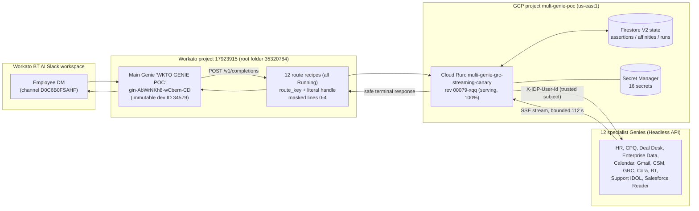
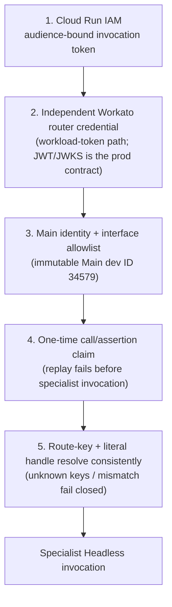
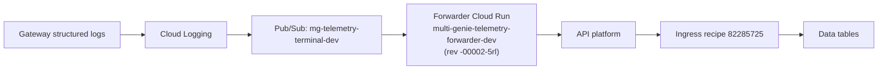
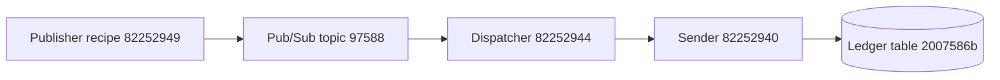

# Multi-Genie Orchestration — architecture diagram (source of truth)

Status: Development POC, complete and frozen pending Product/leadership/BT direction.
Last updated: 2026-10-08, from the project knowledge file (live-verified 2026-10-07)
and `ORCA-CLAUDE-CODE-HANDOFF.md`.

This file is the text source of truth for the architecture diagram. The rendered
artifacts (`closeout/multi-genie-poc-architecture.png` / `.svg`) predate the
Firestore V2 state refactor, the telemetry chain, and revision `00079-xqq`; treat
those as historical. Regenerate from this file when a rendered image is needed.

## 1. Interactive routing topology (the happy path)

Division of responsibility: Main decides **who** owns a request; the specialist
decides **what** it may do for the authenticated employee; the gateway makes the
handoff and return path reliable without owning either decision.

Route recipe IDs (verified live 2026-10-07): HR 82247224, CPQ 82247223,
Deal Desk 82269830, Enterprise Data 82270328, Calendar 82279424, Gmail 82279805,
CSM 82279804, GRC 82245408, Cora 82248493, BT 82252220, Support IDOL 82248279,
Salesforce Reader 82280113. Legacy exceptions still running: HR 82148855,
CPQ 82148859 (not current routes; do not delete casually).

## 2. Gateway auth layers (in order, all must pass)

Identity invariant (non-negotiable): user text is never authority for identity,
permissions, connection state, or confirmation. The trusted subject comes from
Workato skill context, forwarded server-side as `X-IDP-User-Id`. Main never
passes a user's VUA/OAuth token to a sub-agent. The specialist is the
authorization boundary and emits `runtime_connection.auth_required` to produce
an official short-lived link only.

## 3. Telemetry chain (fire-and-forget; the gateway never waits on it)

Privacy-safe only: no persisted prompts, final responses, auth URLs, raw
provider events, or provider credentials anywhere in the chain.

## 4. HR notification path (SEPARATE from interactive routing)

This path is separate from interactive routing and from orchestration
operational alerts. Do not merge them.

## Known state-drift flags (as of 2026-10-08)

- Serving revision `00079-xqq` does NOT include the 2026-10-07 local gateway
  correlation fixes (conversation_busy terminalization, withGatewayRunId
  decoration). Those are local-only in `streaming-gateway/src/` until the full
  deployment procedure runs (zero-traffic candidate first).
- Route registry is code-ready and fail-closed but NOT active.
- Both Cloud Run services have `ingress: all` — privacy is enforced by IAM
  (`roles/run.invoker`), not network ingress. Either fix the prose or set
  ingress to `internal` before any release gate.

## Keeping this current

Update this file whenever any of these change, in the same session that changed
them: revision/service config, route recipe set or IDs, auth-layer design,
telemetry chain, notification paths, or the drift flags above. Bump the
"Last updated" line, and note the verification date you are citing. Source
precedence when facts conflict: UAT ledger > program memory > routing-policy
JSON > Sept runbooks > evidence log > old handoffs (see
`ORCA-CLAUDE-CODE-HANDOFF.md`, "Source precedence and freshness").

## Related (KB bridges)

<!-- kb-bridges:v1 begin -->
- [Multi-Genie Orchestration POC Architecture](../../../../kb-corpus/confluence/extbt/2870903050-multi-genie-orchestration-poc-architecture.md)
- [Adding specialist Genies and MCPs to Multi-Genie Orchestration](../../../../kb-corpus/confluence/extbt/2872377507-adding-specialist-genies-and-mcps-to-multi-genie-orchestration.md)
<!-- kb-bridges:end -->
